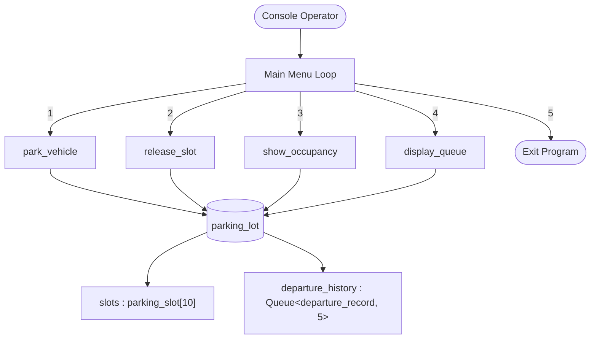

# Projecty - Smart Parking Slot Tracker {#mainpage}

Welcome to the technical documentation for **Projecty**, a high-performance terminal-based parking lot management system built with modern **C++23**.

---

## Project Overview

**Projecty** demonstrates the practical application of fundamental data structures within a real-world systems simulation:
- **Fixed-size array** for active parking slot allocation and state tracking.
- **Templated circular queue (ring buffer)** with $O(1)$ operations for logging recent departures, automatically evicting the oldest entries when full.
- **Robust console I/O** leveraging modern C++23 features such as `std::format` alongside comprehensive input validation.

---

## Key Features

- **10 Dedicated Parking Bays**: First-Come-First-Served (FCFS) slot assignment mechanism with real-time status and vehicle registration tracking.
- **Circular Departure History**: Fixed-capacity ring buffer holding the 5 most recent vehicle departures with automatic overwriting.
- **Zero Dynamic Allocation**: Fixed memory footprint designed for predictable memory usage and embedded-style reliability.
- **Modern C++23 Implementation**: Built with `std::format`, strong typing, ANSI escape terminal controls, and clean modular header design.
- **Operator Console**: Interactive, intuitive text menu with input guards against EOF, malformed entries, and out-of-range slot numbers.

---

## Architecture & Data Structures



### Core Structures Summary

| Structure / Class | Purpose | Time Complexity | Memory Storage |
| :--- | :--- | :--- | :--- |
| parking_slot | Stores slot ID, occupancy status, and vehicle string | O(1) lookup by ID | Stack / Contiguous |
| departure_record | Records vehicle ID and released slot number | O(1) creation | Contiguous in buffer |
| Queue | Generic circular buffer template class | O(1) enqueue / status | Fixed array buffer |
| parking_lot | Central container for 10 slots and departure queue | O(N) first-fit park, O(1) release | Fixed contiguous memory |

---

## Codebase Navigation

Explore the primary modules and interfaces:

### Header Files
- `src/includes/parking.hpp`: Core parking lot definitions, capacities, structs, and slot operations (`park_vehicle`, `release_slot`, `show_occupancy`).
- `src/includes/queue.hpp`: Generic circular queue template class `Queue<T, Capacity>`.
- `src/includes/departure_queue.cpp`: History presentation and formatted queue iteration logic (`display_queue`).
- `src/includes/utils.hpp`: Terminal manipulation (`clearScreen`, `printHeader`) and safe input parsers (`readInt`, `getPositiveInt`, `readString`).
- `src/main.cpp`: Main application entry point and interactive operator menu loop.

### Key Types & Data Structures
- parking_lot : Central manager structure.
- parking_slot : Represents an individual parking bay (Slots 1–10).
- departure_record : Vehicle departure event payload.
- Queue : Generic circular queue template with overwrite semantics.
- departure_queue : Type alias for `Queue<departure_record, HISTORY_CAPACITY>`.

### Key Functions
- init_parking_lot() : Initializes all slots to available state.
- park_vehicle() : Allocates first free slot to a vehicle.
- release_slot() : Frees a slot and logs departure in the circular queue.
- show_occupancy() : Renders an ASCII table showing slot occupancy and totals.
- display_queue() : Iterates through circular queue and displays recent departures.

---

## Getting Started

### Prerequisites
- A compatible C++23 compiler (GCC 14+, Clang 17+, or MSVC 19.35+).
- [Xmake](https://xmake.io) build tool, **or** [Docker](https://www.docker.com/).

### Option A: Local Build with Xmake
```bash
# Build the project
xmake

# Run the application
xmake run projecty
```

### Option B: Containerized Build with Docker
```bash
# Build container image
docker build -t projecty .

# Run interactive container
docker run --rm -it projecty
```

---

## Generating & Updating Documentation

Documentation is generated using **Doxygen**:

```bash
# From the repository root:
doxygen Doxyfile
```

The compiled HTML site is output directly to the `docs/` directory. Open `docs/index.html` in your web browser to view the generated site.
